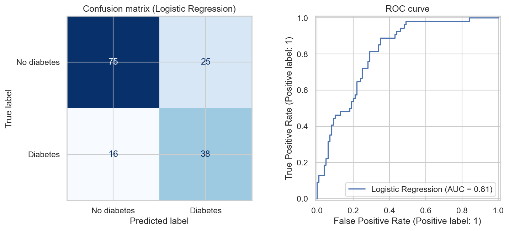
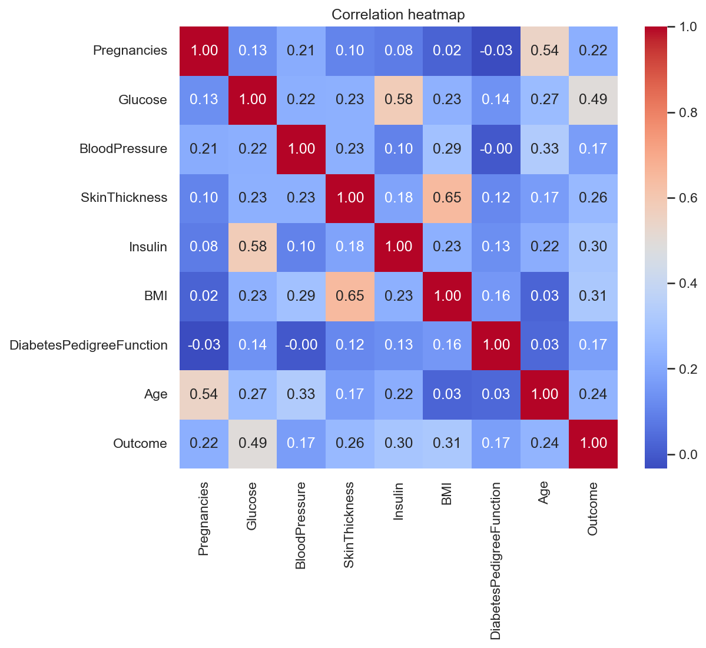
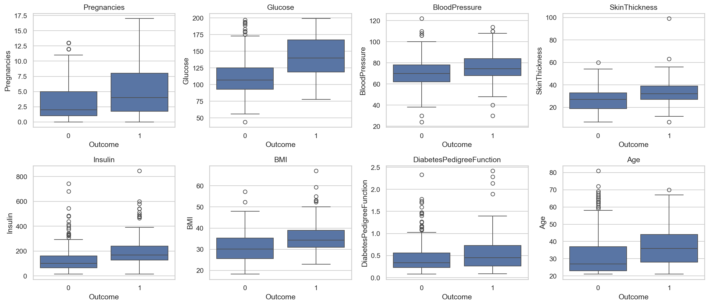

<p align="center"></p>
<p align="center"></p>
<p align="center"><a href="https://github.com/khnbutt118-dev">← Profile</a> · <a href="https://hassanbuttportfolio.vercel.app/">Portfolio</a> · <a href="https://www.linkedin.com/in/hassan-butt-ab0036334/">LinkedIn</a></p>

# 🩺 Diabetes Risk Screening App
**End-to-end machine-learning demo · Pima Indians Diabetes Database**

> Educational screening demonstration only — **not a medical diagnostic tool**.

<table>
<tr><td align="center"><h2>768</h2><sub>Rows analysed</sub></td><td align="center"><h2>0.813</h2><sub>Test ROC-AUC</sub></td><td align="center"><h2>0.704</h2><sub>Test recall</sub></td><td align="center"><h2>0.734</h2><sub>Test accuracy</sub></td></tr>
</table>

## ✨ At a glance

This project takes a tabular health dataset through cleaning, exploratory analysis, model comparison and a Streamlit interface. The selected model was Logistic Regression based on cross-validated ROC-AUC.

## 📊 Model evaluation

<p align="center"></p>

| Test metric | Result |
|:--|--:|
| Best model | **Logistic Regression** |
| ROC-AUC | **0.813** |
| Recall | **0.704** |
| Accuracy | **0.734** |
| Dataset size | **768 rows** |

## 🔍 What the data showed

<table>
<tr><td width="33%"><b>Glucose</b><br><sub>Strong predictive signal in this dataset</sub></td><td width="33%"><b>BMI</b><br><sub>Among the influential model features</sub></td><td width="33%"><b>Pregnancies</b><br><sub>Also influential in the fitted model</sub></td></tr>
</table>
<p align="center"></p>
<p align="center"></p>

## 🧹 Data preparation

- Treated biologically implausible zero values in Glucose, BloodPressure, SkinThickness, Insulin and BMI as missing.
- Performed median imputation inside the modelling pipeline to avoid leakage.
- Compared Logistic Regression and Random Forest with class weighting and stratified 5-fold cross-validation.

## ▶️ Run locally

```bash
pip install -r requirements.txt
python main.py
streamlit run app.py
```

## 🗂️ Repository contents

| Path | Purpose |
|:--|:--|
| `main.py` | Analysis and modelling pipeline |
| `app.py` | Streamlit demo |
| `data/` | Dataset instructions |
| `outputs/` | Figures and reports |
| `model/` | Saved model and feature metadata |

<details>
<summary><b>Dataset and methodology</b></summary>

- Dataset: [Pima Indians Diabetes Database](https://www.kaggle.com/datasets/uciml/pima-indians-diabetes-database)
- 768 rows × 9 columns
- 35% of records in the dataset have diabetes.
- The pipeline compares Logistic Regression and Random Forest using stratified cross-validation.
</details>

---
<p align="center"><b>Responsible ML:</b> model outputs are estimates from a historical dataset and must not be used to diagnose, treat or make individual clinical decisions.</p>