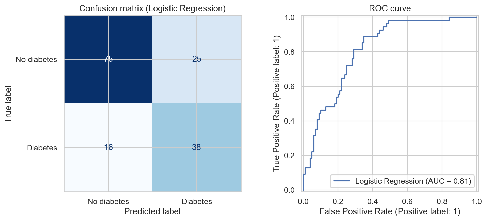
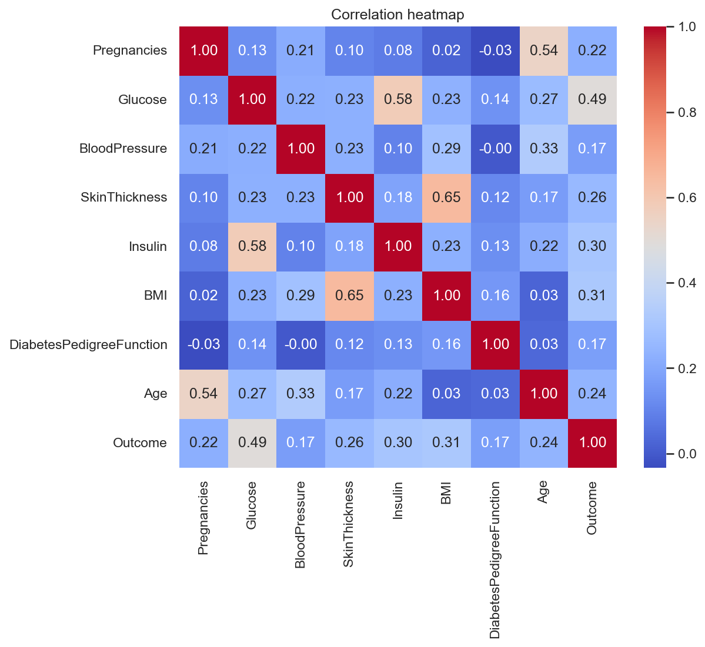
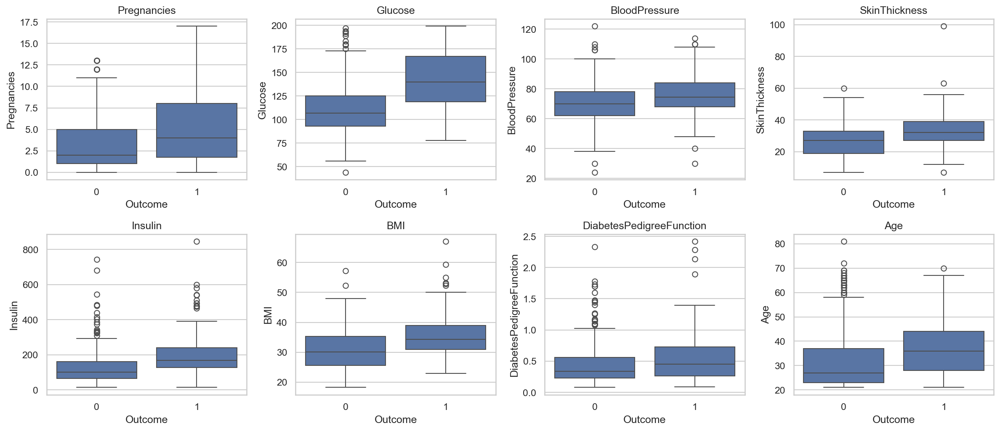

# End-to-End Project: Diabetes Risk Screening App

> Synent Technologies Data Science Internship | Task 9 (Advanced level) | Author: Hassan Butt

## Problem statement
Build a complete data-science project: collect, clean, explore, model and deploy a diabetes risk screening demo.

## Dataset details
- **Dataset:** Pima Indians Diabetes Database
- **Source:** https://www.kaggle.com/datasets/uciml/pima-indians-diabetes-database
- **Size used:** 768 rows x 9 columns

## Approach
1. Data collection from the Pima Indians Diabetes dataset
2. Cleaning: impossible zeros treated as missing, imputed inside the pipeline (no leakage)
3. EDA: class balance, distributions by outcome, correlation heatmap
4. Model building with class weighting and 5-fold stratified cross-validation (Logistic Regression vs Random Forest)
5. Deployment with Streamlit: user input produces a prediction and risk band

## Results
| Metric | Value |
|---|---|
| Best model | Logistic Regression |
| Test ROC-AUC | 0.813 |
| Test recall | 0.704 |
| Test accuracy | 0.734 |
| Patients | 768 |

**Key insights**

- 35% of patients in the data have diabetes, so class weighting and recall were used to avoid missing positive cases.
- Zeros in Glucose, BloodPressure, SkinThickness, Insulin, BMI are biologically implausible placeholders for missing values, so they were treated as missing and imputed with medians inside the pipeline.
- Logistic Regression gave the best cross-validated ROC-AUC and reached test recall 0.704 and ROC-AUC 0.813.
- The most influential factors were Glucose, BMI, Pregnancies.
- This is an educational screening demo, not a medical diagnosis tool.

**Figures**





**Other output files:** `model/model.joblib`, `model/feature_info.json`, `cross_validation_results.csv`, `test_metrics.json`, `app.py`

## How to run
```bash
pip install -r requirements.txt
python main.py
streamlit run app.py
```

## Deployment
Deploy for free on Streamlit Community Cloud: push this repository to GitHub, choose the repo, set the main file to `app.py`.

> Educational demo only. Not a medical diagnostic tool.

## Project structure
```
main.py            # full analysis / pipeline
app.py             # Streamlit app
requirements.txt
data/              # dataset (see data/README.md)
outputs/           # figures, tables and reports
model/             # trained model + feature info
```

## Academic integrity
All analysis code and write-ups in this repository were written by the author. The dataset belongs to its original creators (see link above).
